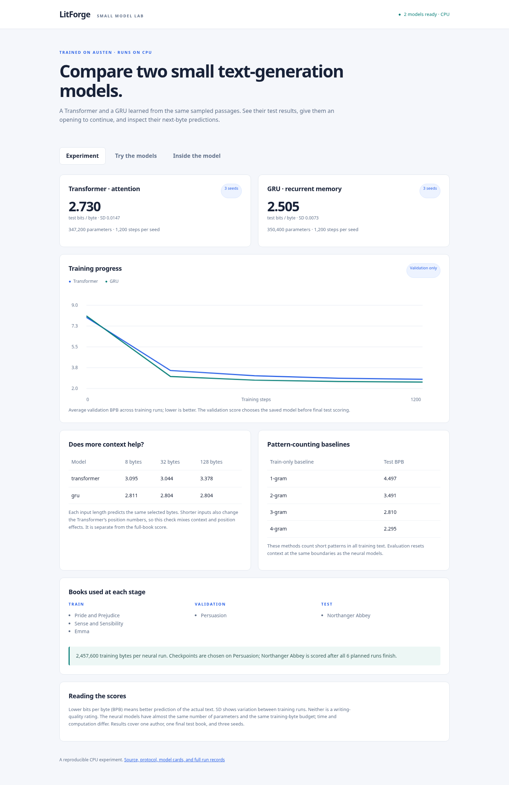

# LitForge

[](https://github.com/Suryanshu24052006/Litforge-/actions/workflows/ci.yml)

LitForge trains small models to continue passages of text. It compares a Transformer and a GRU with a simpler method that counts short text patterns.

Both neural models learned from three Jane Austen books. A local web app lets you try them, view the test results, and inspect their predictions. The trained files are included, and everything runs on a CPU.

## Run the app

Install [uv](https://docs.astral.sh/uv/) and use Python 3.11–3.13:

```bash
git clone https://github.com/Suryanshu24052006/Litforge-.git
cd Litforge-
uv sync --frozen --extra dev
uv run --frozen python -m litforge verify-models
uv run --frozen python -m litforge serve
```

Open **http://127.0.0.1:8000**. Start with `It was a quiet evening, and ` in **Try the models**. Use the same opening and settings for both models to compare their output. Temperature controls how varied the sampling is.

**Experiment** has the training curves and test scores. **Inside the model** shows likely next bytes and a selected attention head's weights. The GRU uses recurrent memory, so it has no attention matrix.

<details>
<summary>App screenshot</summary>



</details>

## What was compared

The Transformer has 347,200 parameters; the GRU has 350,400. Each was trained three times, using the same sampled passages and byte budget for each seed. Training time and total computation were not matched.

| Purpose | Books |
|---|---|
| Training | Pride and Prejudice, Sense and Sensibility, Emma |
| Choosing the saved model | Persuasion |
| Final test | Northanger Abbey |

The models predict UTF-8 bytes. A basic English letter takes one byte; some characters take several. Both models can use up to 128 bytes of recent input.

## Results

| Method | Test BPB ↓ |
|---|---:|
| **4-gram** | **2.295** |
| GRU | 2.505 |
| Transformer | 2.730 |

**Lower bits per byte (BPB) means better prediction of the actual test text.** It isn't an accuracy percentage or a writing-quality score. Neural results are averages across three runs.

The GRU scored better than the Transformer. The 4-gram baseline beat both: it predicts a byte using counts of patterns with up to three preceding bytes. It counts all training text directly, whereas neural training samples passages repeatedly.

The [full results](docs/STUDY.md) include the other baselines, variation between runs, and actual generated passages. Raw records are in [artifacts/study](artifacts/study/).

## What still falls short

The models invent words, repeat phrases, and lose track of a passage. The final test covers one book by one author. More books and larger training budgets would be needed to judge how broadly the result holds.

The context-length check also has a limitation: shortening the input changes the Transformer's position numbers. Its scores mix context length with position effects. The attention picture shows mixing weights, not a full explanation of a prediction.

See [validation notes](docs/VALIDATION.md) for the 40-test suite and the browser and fresh-checkout checks.

## Code and notes

- [Developer guide](docs/DEVELOPMENT.md): commands and a map of the code.
- [Model card](docs/MODEL_CARD.md): architecture, training settings, and limits.
- [Data](DATA.md): book sources and preparation.
- [References](docs/REFERENCES.md): papers, libraries, and implementations consulted.

The [earlier Shakespeare results](docs/RESULTS.md) and [performance notes](docs/PERFORMANCE.md) use different data and score units.

## Maintainer

[Suryanshu Chandel (@Suryanshu24052006)](https://github.com/Suryanshu24052006). Project credit is in [CONTRIBUTORS.md](CONTRIBUTORS.md); setup and pull-request notes are in [CONTRIBUTING.md](CONTRIBUTING.md).

Code is [MIT licensed](LICENSE). Training-text sources and terms are listed in [DATA.md](DATA.md).
