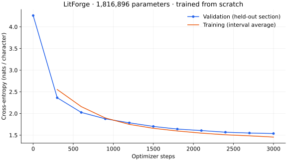

# Measured results

These measurements come from training the models in this workspace. Both started from random weights and used seed 42. The best checkpoint was selected using validation loss; the test section was scored separately.

| Run | Parameters | Steps | Training time | Initial → best validation loss | Test perplexity / character | Unigram baseline | Bigram baseline |
|---|---:|---:|---:|---:|---:|---:|---:|
| cpu | 813,952 | 600 | 32.8 s | 4.186 → 2.368 | 10.75 | 28.85 | 12.06 |
| demo | 1,816,896 | 3,000 | 757.6 s | 4.260 → 1.538 | 5.29 | 28.85 | 12.06 |

The test section contains 55,769 scored next-character targets. The unigram baseline is fitted only on training frequencies. Training time excludes corpus download, dependency installation, initial validation, and final test evaluation; it includes periodic validation and checkpoint writes. These are single CPU runs, not a controlled hardware benchmark.



## Interpretation

Lower held-out perplexity than a unigram baseline shows that the transformer learned contextual character patterns. It does not establish fluent writing or general-purpose reasoning. The corpus is small, uses one author, and is split by contiguous sections rather than by independent works. Samples can contain malformed words, repetition, and incoherence.

## Reproduce

The exact commands are in the root README. Full configurations, corpus digests, training logs, evaluations, and checkpoints remain under `runs/`. To refresh this report after both runs finish:

```bash
uv run --frozen --extra plots python scripts/plot_run.py runs/demo
uv run --frozen python scripts/report_results.py
```
