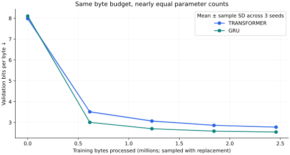
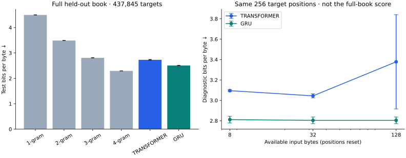

# Whole-book generalization study

How do nearly parameter-matched Transformer and GRU models generalize to an unseen Austen book under the same training-byte budget?

This is a small, reproducible comparison, not a claim of a new model architecture or a production writing assistant. All quantities below come from the committed run records.

## Protocol

Protocol SHA256: `dabdc1e35f9b7571ab96a3f6cac64022a4c6e5611ca6c1c551d4802326ad9497`.
Dataset SHA256: `fd6403e1d1d186ba495713d95dcffa583ff249911e2b28b01da56f99b1b447bc`.

Each neural run processes 2,457,600 training bytes. Seeds: 17, 42, 73. Models have nearly equal parameter counts. Wall time and FLOPs are not matched. AdamW uses the same learning rate, schedule, batch size, and context length for both architectures; this is a fixed shared recipe rather than individually optimized hyperparameters.

Training windows never cross book boundaries. UTF-8 byte tokenization has a fixed vocabulary of 256, so held-out books cannot introduce unknown tokens. Gutenberg headers and footers are removed. These byte-level scores are not directly comparable to the original character-level Shakespeare results.

| Split | Book | Normalized bytes |
|---|---|---:|
| train | Pride and Prejudice | 691,960 |
| train | Sense and Sensibility | 673,880 |
| train | Emma | 891,534 |
| validation | Persuasion | 467,010 |
| test | Northanger Abbey | 437,846 |

The audit found 0 exact shared paragraphs of at least 100 whitespace-normalized characters across splits. This does not rule out shorter repeated phrases, paraphrases, or shared style.

Checkpoints are selected only on full-book validation BPB. All preregistered runs must finish before the runner scores the test book. The demo seed is declared in the protocol and is not selected from test results.



## Held-out book results

Lower bits per byte (BPB) is better. Standard deviation is the sample SD across training seeds, not a confidence interval. Three seeds give limited precision.

| Architecture | Parameters | Seeds | Mean test BPB | Sample SD |
|---|---:|---:|---:|---:|
| transformer | 347,200 | 3 | 2.7304 | 0.0147 |
| gru | 350,400 | 3 | 2.5052 | 0.0073 |

| Train-only baseline | Test BPB | Scored bytes |
|---|---:|---:|
| Interpolated order 1 | 4.4973 | 437,845 |
| Interpolated order 2 | 3.4906 | 437,845 |
| Interpolated order 3 | 2.8097 | 437,845 |
| Interpolated order 4 | 2.2946 | 437,845 |

N-gram probabilities use train-only counts, fixed interpolation and smoothing from the protocol, and the same evaluation-window boundaries as the neural models. Baselines fit all available training text; their exposure and compute are not matched to the neural optimization budget.

## Context diagnostic

These scores use the same sampled target positions at every context length. They are a diagnostic, separate from the complete-book score above. Each run records the target-position digest and sample count.

| Architecture | Available context (bytes) | Mean diagnostic BPB |
|---|---:|---:|
| transformer | 8 | 3.0949 |
| transformer | 32 | 3.0440 |
| transformer | 128 | 3.3779 |
| gru | 8 | 2.8112 |
| gru | 32 | 2.8038 |
| gru | 128 | 2.8038 |

Shortening the input also resets the Transformer’s learned positional indices. These probes do not isolate semantic context use from positional sensitivity. A nonmonotonic curve is possible; 256 requested targets and 3 seeds give limited evidence for a general claim that more context helps.



## What the experiment supports

GRU has the lower mean neural test BPB in this study. The order-4 baseline scores lower than both neural architecture means under this budget. This is a result for this dataset, recipe, and budget; it is not a universal architecture ranking.

Whole-book separation is stronger than a random or contiguous within-book split, but the final test contains only one work by one author. No claims about other authors, conversational ability, or human writing quality follow from these scores. More seeds, individually tuned recipes, different test works, and larger budgets are separate experiments.

## Fixed-prompt samples

The following use the preregistered demo seed, identical prompt, generation seed 42, temperature 0.8, and top-k 20. No sample was selected for fluency.

### transformer

```text
It was a quiet evening, and being all that be
ferect ireposed wer con the ot him not the simite to arrraie of the wo which
spter livish the cartion of and on of him, and comf she a live her could
and in prie the she persition ar
```

### gru

```text
It was a quiet evening, and plise all that and her more poon wether to geen and he would simet of hardlate of the was the dayter liver the from nom of she stongs. And agriet be she live heart his for in prie the she, in much thr
```

## Reproduce

```bash
uv sync --frozen --extra dev
uv run --frozen python -m litforge prepare-books
uv run --frozen python -m litforge study --output runs/reproduced-study
```

The protocol, source digests, environment versions, per-seed histories, and evaluations are committed under `artifacts/study/`. Full optimizer/RNG checkpoints stay under ignored `runs/`; small inference weights are bundled under `models/`.
